

  

<h1 align="center">Yohaku · 余白</h1>

  <strong>A Quiet Place Between Words and Sound.</strong> 
  在文字与声音之间，留一处属于自己的空白。

  
  
  
  
  
  

  <a href="https://chaosnap.github.io/Yohaku/">📖 Docs · 文档</a> ·
  <a href="#features">✨ Features</a> ·
  <a href="#screenshots">🖼️ Screenshots</a> ·
  <a href="#download">⬇️ Download</a> ·
  <a href="https://chaosnap.github.io/Yohaku/changelog/">📝 Changelog</a> ·
  <a href="PRIVACY.md">🔒 Privacy</a>

  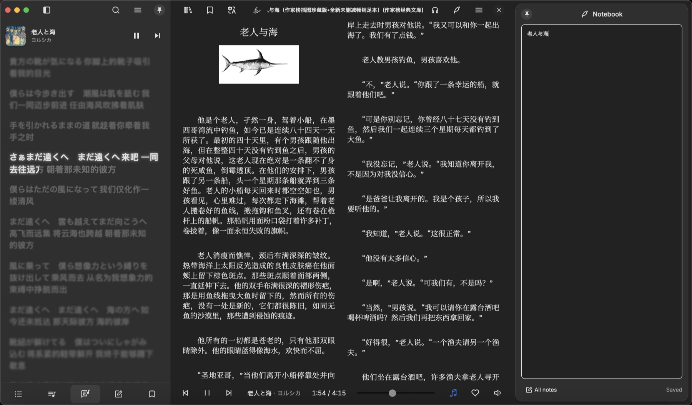

## 🍃 余白 · The blank space

**余白** (*yohaku*) is the blank space left on a page. Yohaku wants to be that kind of space: while you read, put on a record from your own collection, or let it rain outside the window. The book stays where it is, and the music never gets in the way.

It brings **reading** and **listening** into one quiet place: books, comics, your own music collection, lyrics, read-aloud and ambient sound, on Windows, macOS, Linux and Android. Yohaku is built on the open-source reader [Readest](https://github.com/readest/readest). It takes out the accounts, the cloud, the paywall and the telemetry, and adds its own music library, lyrics and ambient sounds, in an interface with plenty of blank space.

The icon is an open book: words on the left page, and the right page almost empty but for one vermilion note. Words, sound, and the space between them: that is 余白.

## ✨ Features

### 📖 Books and comics

- EPUB, MOBI, AZW3, FB2, CBZ, PDF and TXT; horizontal and vertical text, one or two columns.
- Typesetting tuned for Chinese, Japanese and English, and three Yohaku reading themes, each with a day and a night look: **Warm Paper 暖纸**, **Moon White 月白** and **Ink Night 墨夜**.
- Highlights, notes and bookmarks, a notebook card that floats beside the page, a dictionary, translation and full-text search.
- Comics open in the direction their `ComicInfo.xml` gives; you can also make right to left the default.

### 🎵 Your own music library

- **Import a folder** and Yohaku syncs it every time it starts, or **import files** one by one. Your music is only referenced: it is never copied, moved or modified.
- Browse and search by **albums**, **artists**, **songs** and **favorites**. Songs and albums have details pages: year, genre, format, bitrate, sample rate, file size and location.
- Reads tags and embedded covers from FLAC, MP3, AAC / M4A, ALAC, Ogg, Opus, WAV, AIFF and more.
- On Android, music keeps playing in the background and with the screen locked, with controls on the lock screen, in the notification and on Bluetooth headphones.

### 🎧 Listen while you read

- No player floats over the page. Tap 🎵 in the footer and the whole footer becomes a music bar (previous, play, next, progress, favorite, volume); tap it again for the reading footer.
- The volume is a vertical slider that tucks itself away once you're done.
- The sidebar gains **Songs** (queue, all, favorites) and **Lyrics**: `.lrc` files or embedded lyrics flow line by line and fill in word by word, with translations under the original lines.
- Keep your hands on the keyboard: `M` plays or pauses, `,` and `.` go back and forward a song.

### 🌧️ Ambient sounds

- Rain, rain on the eaves, wind, waves, a fireplace, forest, cicadas, night insects, a stream and vinyl crackle: ten sounds, all synthesized by Yohaku, with no files to download.
- Five scenes, one tap each: **Rainy Night 雨夜**, **Summer Afternoon 夏日午后**, **Seaside at Dusk 黄昏海边**, **Night Aquarium 夜间水族馆** and **Winter Study 冬日书房**. Every sound has its own switch and volume.
- They play on their own or beside music and read-aloud, and they always start silent.

### 🗣️ Read aloud

- The read-aloud panel at the top right reads from the current page, highlighting sentence by sentence, with speech rate and a sleep timer.
- System voices by default; online voices if you turn them on.

### 🔒 Quiet and private

- No account, no cloud, no paywall and no telemetry. Yohaku does not go online when it starts.
- Library sync only uses what you set up yourself: WebDAV, S3, KOReader or OPDS. See the [privacy note](PRIVACY.md).

## 🖼️ Screenshots

### 📚 Reading and the library

<table>
  <tr>
    <td colspan="2">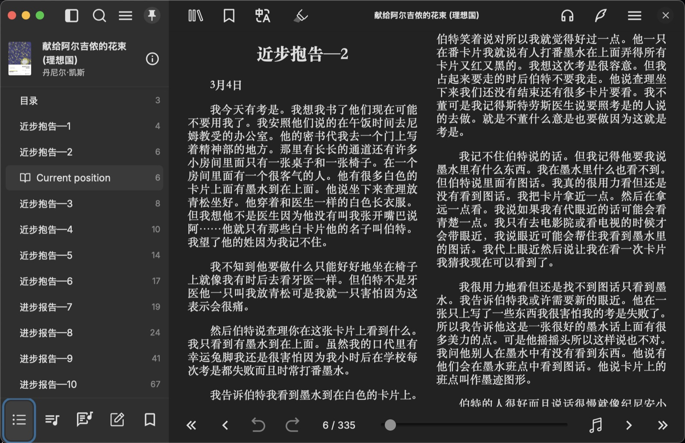 Contents in the sidebar, the text in two columns, the reading footer below</td>
  </tr>
  <tr>
    <td width="50%"> The library; Books / Music at the top switches between them</td>
    <td width="50%">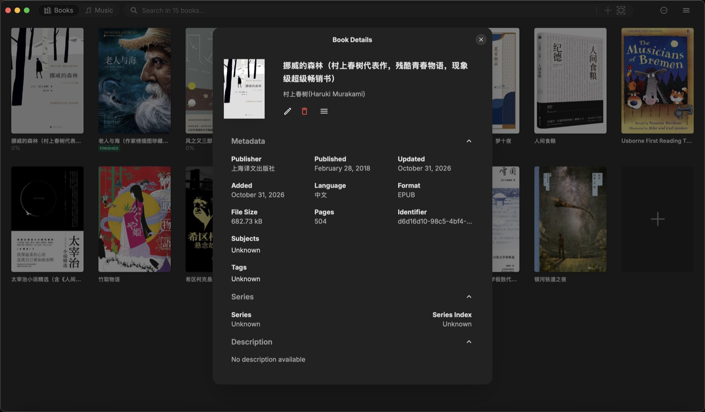 Book details; the last tile, “+”, imports new books</td>
  </tr>
</table>

### 🎵 The music library

<table>
  <tr>
    <td width="50%">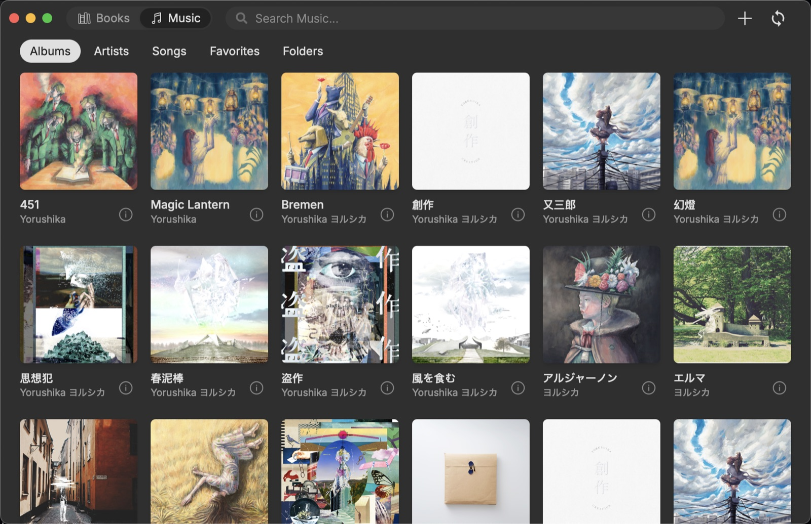 Albums, artists, songs, favorites and folders</td>
    <td width="50%">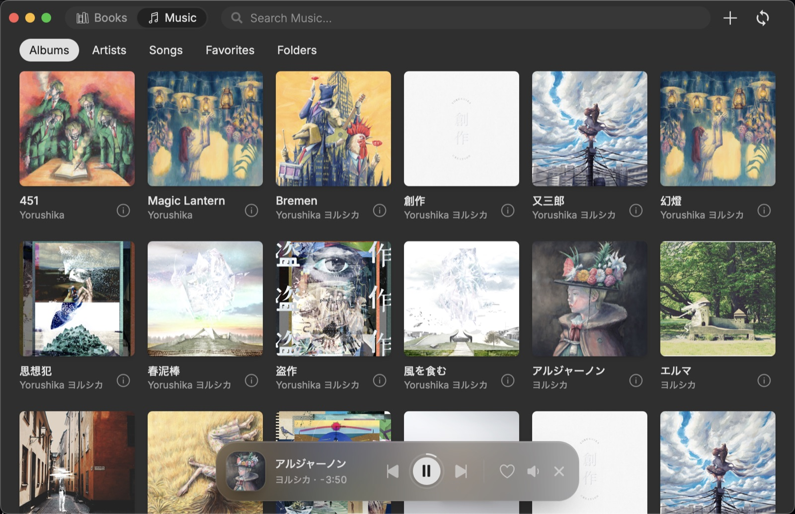 Listening on its own: a frosted-glass player at the bottom</td>
  </tr>
  <tr>
    <td width="50%">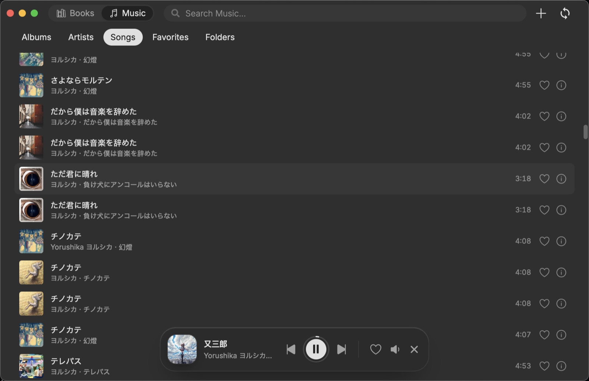 Songs: the heart for favorites, ⓘ for details</td>
    <td width="50%">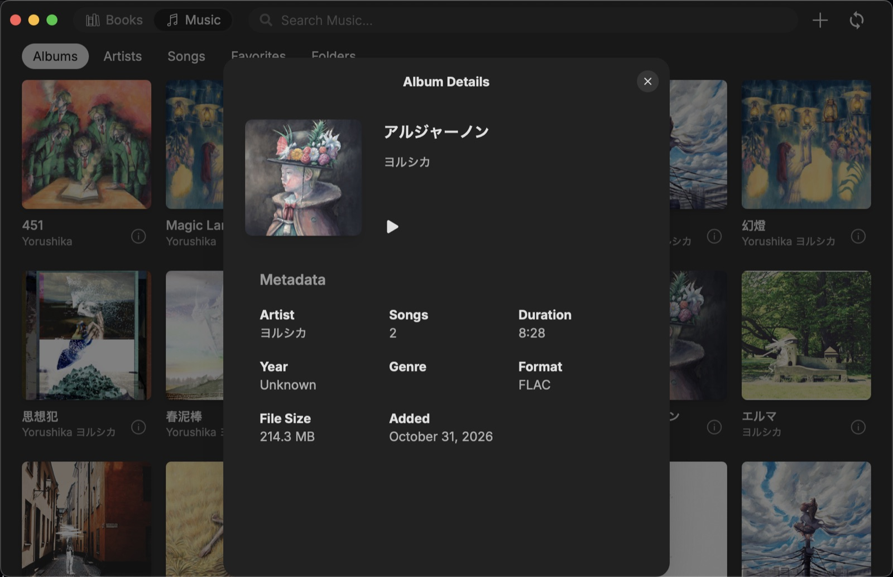 Album details</td>
  </tr>
</table>

### 🎧 Listening while reading

<table>
  <tr>
    <td colspan="2">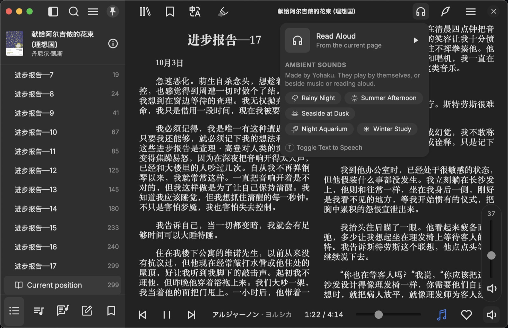 The read-aloud panel and ambient sounds at the top right; the footer turned music bar, with its vertical volume</td>
  </tr>
  <tr>
    <td width="50%">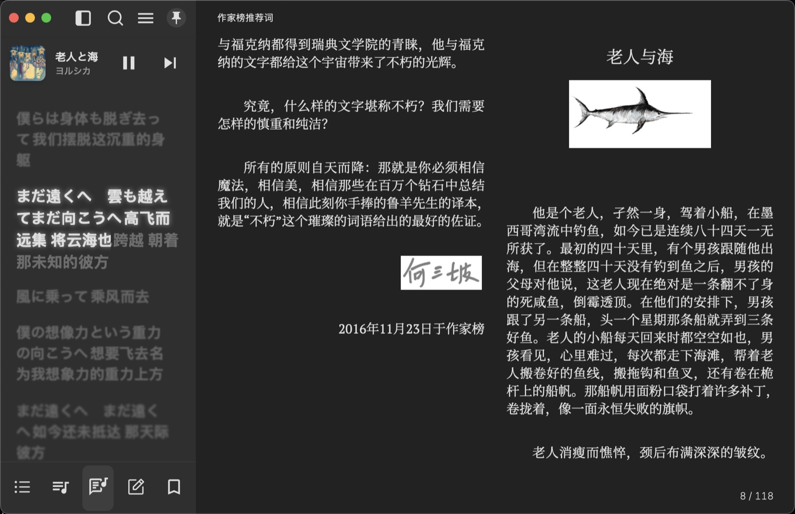 Lyrics flow line by line, translations beneath</td>
    <td width="50%">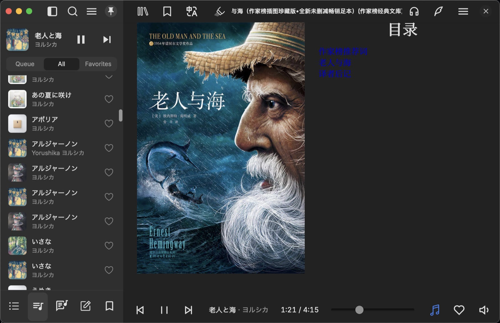 Change songs without leaving the page</td>
  </tr>
</table>

### 📱 Android

  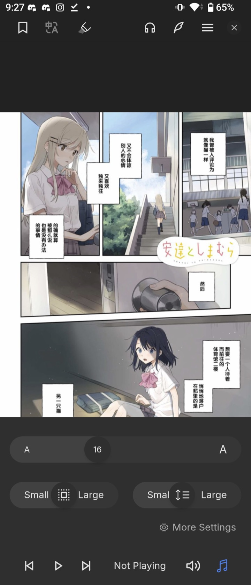
  &nbsp;&nbsp;
  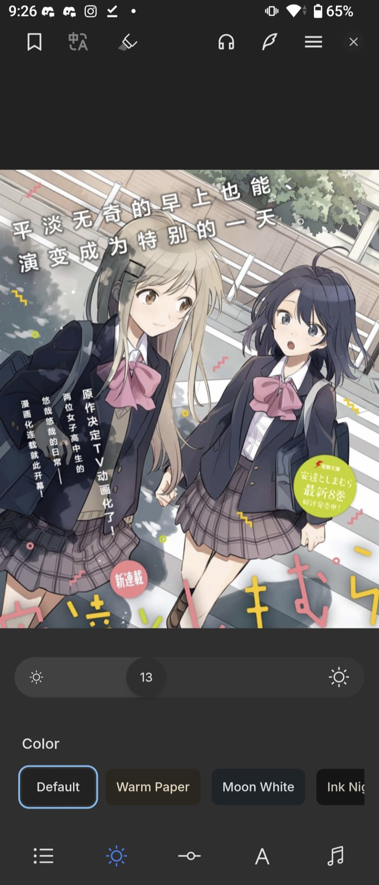

Comics on a phone: the footer turns into a music bar here too; the three Yohaku reading themes

## ⬇️ Download

Get the build for your platform from [Releases](https://github.com/Chaosnap/Yohaku/releases/latest):

| Platform | File | Notes |
|---|---|---|
| 🪟 Windows | `…_windows_x64-setup.exe` (installer), `…_windows_x64-portable.exe` (portable) | SmartScreen may warn you: choose “More info → Run anyway” |
| 🍎 macOS | `…_macos_universal.dmg` | Not notarized yet: if macOS blocks the first launch, click “Open Anyway” in System Settings → Privacy & Security |
| 🐧 Linux | `…_linux_amd64.AppImage`, `…_linux_amd64.deb` | x86_64 |
| 🤖 Android | `…_android_arm64.apk` (most phones), `…_android_armv7.apk` (older 32-bit phones) | Android 8.0 or later |

Every release comes with `SHA256SUMS.txt` and GitHub build provenance attestations. Step-by-step instructions, in Chinese: [安装](https://chaosnap.github.io/Yohaku/guide/install).

## 📚 Documentation

**[chaosnap.github.io/Yohaku](https://chaosnap.github.io/Yohaku/)** has the full guide, the changelog and the development documents, written in Simplified Chinese (文档使用简体中文):

| Section | What's in it |
|---|---|
| [指南 · Guide](https://chaosnap.github.io/Yohaku/guide/) | Installing, books and comics, the music library, listening while reading, lyrics, ambient sounds, read-aloud, shortcuts, privacy, FAQ |
| [更新日志 · Changelog](https://chaosnap.github.io/Yohaku/changelog/) | What changed in every release |
| [开发文档 · Development](https://chaosnap.github.io/Yohaku/dev/) | Product vision, feasibility study, architecture, roadmap, CI and releases, every change made to Readest |

The site is built from [`website/`](website/) and the documents in [`docs/yohaku/`](docs/yohaku/).

## 🗺️ Where it stands

**Yohaku 2.0**: reading, the music library, lyrics, ambient sounds and read-aloud all work. Next comes the **darkroom (暗室)**: a quiet space of your own for books and records, and after it a gramophone and more sounds. See the [roadmap](https://chaosnap.github.io/Yohaku/dev/03-roadmap).

## 🛠️ How it's built

- Only code and assets live here: **everything is compiled, tested, packaged and released on GitHub Actions**, so no installer comes from anyone's own computer. See [云端构建](https://chaosnap.github.io/Yohaku/guide/building).
- `references/` (not committed) holds read-only clones of upstream and reference projects; `local/` (not committed) holds raw assets and drafts.
- Signing keys live only in GitHub Secrets and offline backups, never in the repository.
- The icon's source is [`assets-src/icon/yohaku-icon.svg`](assets-src/icon/yohaku-icon.svg), from which every platform's icons are generated; the screenshots are in [`docs/screenshots/`](docs/screenshots/).

## 📜 License and credits

Yohaku is built on [Readest](https://github.com/readest/readest) (© Bilingify LLC) and, like Readest, is open source under the **[GNU AGPL-3.0](LICENSE)**. The reading engine is [foliate-js](https://github.com/johnfactotum/foliate-js) (MIT). The per-character timing and glow of the lyrics follow the approach of [Folia](https://github.com/chthollyphile/folia-major) (AGPL-3.0), with the code written from scratch. Book and album covers in the screenshots belong to their respective owners.
