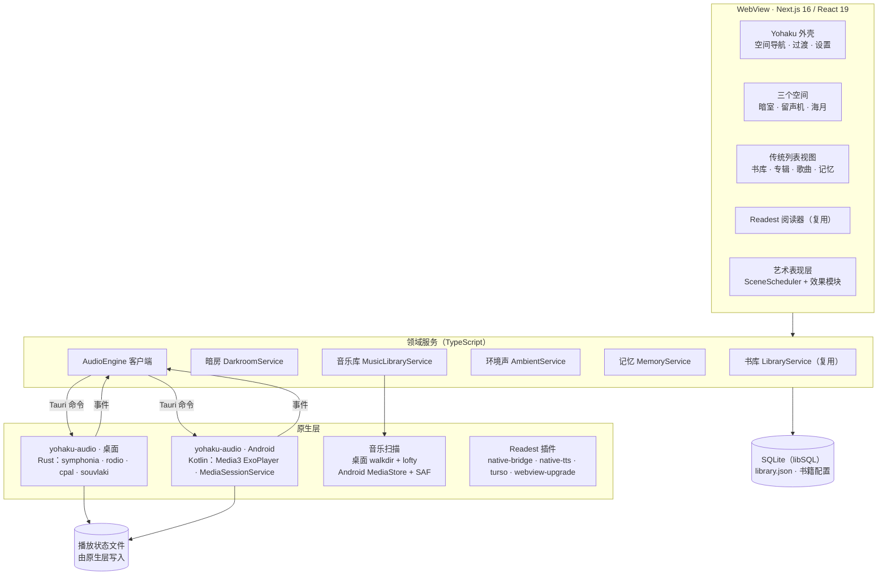
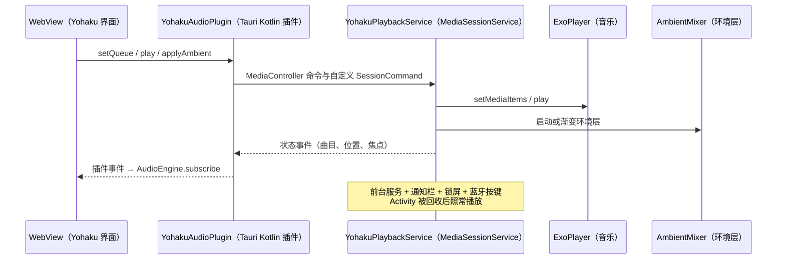

# Yohaku 系统架构设计

> 版本 v1 · 2026-10-30 · 前提：采用[可行性评估](01-feasibility.md)推荐的路线 A（Fork Readest）。
> 本文描述目标架构；具体实现会在各 Phase 中细化，偏离本文的决定应回写到这里。

---

## 1. 总体架构



三条基本分工：

1. **WebView 只负责呈现与交互。** 阅读器、空间、列表视图、设置都在 WebView 中；任何需要在后台持续运行的逻辑都不放在这里。
2. **原生层负责声音。** 音乐队列、无缝衔接、环境声音混音、淡入淡出、睡眠定时、媒体会话、播放状态持久化，全部由原生引擎完成。WebView 被节流、刷新甚至销毁，都不影响播放。
3. **数据统一存放。** 书籍数据沿用 Readest（`library.json` + 书籍配置 + SQLite），Yohaku 新增的数据全部进入同一个 SQLite 数据库，通过 Readest 的迁移框架管理；只有播放状态由原生层自己写文件，保证后台时也能可靠保存。

---

## 2. 仓库结构与上游同步

### 2.1 目录结构（Phase 0 完成后）

```text
Yohaku/
├── apps/readest-app/                 # 保留上游目录名，降低合并冲突
│   ├── src/                          # 上游代码：尽量少改，改动处标注 [yohaku]
│   │   └── yohaku/                   # 🆕 Yohaku 前端代码
│   │       ├── shell/                #   空间导航、过渡、Yohaku 设置
│   │       ├── spaces/anshitsu/      #   暗室
│   │       ├── spaces/gramophone/    #   留声机
│   │       ├── spaces/kurage/        #   海月
│   │       ├── art/                  #   SceneScheduler、物理、WebGL 工具、效果模块
│   │       ├── audio/                #   AudioEngine 接口、Tauri 实现、Mock 实现
│   │       ├── music/                #   音乐库服务与列表视图
│   │       ├── ambient/              #   环境声音场景、预设、混音界面
│   │       ├── memory/               #   声音书签、胶卷、私人场景
│   │       ├── db/                   #   yohaku_* 数据表迁移
│   │       └── build.ts              #   isYohakuBuild()：Yohaku 构建开关（.env.tauri）
│   ├── public/yohaku/                # 🆕 运行时素材（压缩后的纹理、音效）
│   └── src-tauri/
│       ├── src/yohaku/               # 🆕 Rust：音乐扫描等应用级命令
│       └── plugins/tauri-plugin-yohaku-audio/   # 🆕 音频插件
│           ├── src/desktop.rs        #   桌面引擎（Rust）
│           ├── src/mobile.rs         #   转发到 Android
│           └── android/              #   Kotlin：MediaSessionService、环境层
├── packages/                         # 上游子模块（foliate-js、Tauri 分叉等）
├── assets-src/                       # 🆕 可公开的素材源文件 + LICENSES.md
├── docs/yohaku/                      # 🆕 本系列文档
├── references/                       # 本地参考克隆（.gitignore，不提交）
└── local/                            # 本地原始素材（.gitignore，不提交）
```

插件的组织方式与 Readest 的 `tauri-plugin-native-tts` 完全一致（`desktop.rs` + `mobile.rs` + `android/`），同一个插件名在桌面路由到 Rust、在 Android 路由到 Kotlin。

### 2.2 上游同步规则

- 远程仓库：`origin` = `Chaosnap/Yohaku`，`upstream` = `readest/readest`。导入时保留 Readest 的完整历史（`git merge --allow-unrelated-histories`），以后每次同步都是普通的 `git merge upstream/main`。
- **少改上游文件**：品牌替换走配置与 i18n 后处理，功能关闭走 `isYohakuBuild()`（`src/yohaku/build.ts`），新功能放在 `yohaku/` 目录。确实需要改动的上游文件，在改动处加 `// [yohaku] 原因` 注释，并登记在 `docs/yohaku/upstream-patches.md`。
- **节奏**：每月一次。在独立分支上合并上游，CI 全绿且真机冒烟测试通过后再合入 `main`。可选：定时工作流自动尝试合并并开 PR（见 [04 · CI](04-ci-release.md#8-上游同步工作流)）。
- 子模块（foliate-js、Tauri 分叉等）跟随 Readest 的固定提交；为防止上游仓库变动造成构建中断，可把这些分叉镜像到 `Chaosnap` 账号下。

### 2.3 品牌替换清单

| 项目 | Readest | Yohaku |
|---|---|---|
| 产品名 / 可执行文件 | Readest / readest | Yohaku / yohaku |
| 应用标识 | `com.bilingify.readest` | `io.github.chaosnap.yohaku`（待确认） |
| Android 包名与 `MainActivity` 路径 | `com.bilingify.readest` | 同上；插件内部包名（如 `com.readest.native_tts`）保持不变以减少改动 |
| 深链接 | `readest://`、Google Drive / OneDrive 回调 | `yohaku://`；移除 OAuth 回调 |
| 图标 | Readest 图标 | Phase 0 先用占位图标，Phase 3 换为正式图标 |
| 数据目录与资源作用域 | `**/Readest/**` | `**/Yohaku/**`，与 Readest 共存时互不干扰 |
| D-Bus ID、窗口标题、NSIS 安装信息 | Readest | Yohaku |
| 界面文案中的「Readest」 | 数百条翻译 | 在 i18n 层加一个后处理器统一替换，不逐个修改翻译文件 |
| 关于页面 | — | 写明「基于 Readest（AGPL-3.0）」并附源码地址 |

---

## 3. 音频架构

### 3.1 原则

1. **原生层拥有播放。** 队列、切歌、淡变、计时都在原生引擎内部完成；WebView 只是遥控器与显示器。
2. **不做任何强制处理。** 默认不加均衡、不加压缩、不加底噪；音量为 100% 时只做必要的格式转换。
3. **一个焦点拥有者。** 音乐与环境声音共享一个音频焦点与媒体会话，避免互相打断或在锁屏上出现两个播放器。
4. **环境声音是独立的一层。** 它有自己的总音量与每层音量，可以单独播放，也可以与音乐叠加。

### 3.2 统一接口

界面只与下面这个接口交互。桌面实现调用 Rust 命令，Android 实现调用 Kotlin 插件命令；另有一个基于 Web Audio 的 Mock 实现，用于 Web 预览与自动化测试。

```ts
// src/yohaku/audio/engine.ts
export interface TrackRef {
  id: string;          // music_track.id
  uri: string;         // 桌面为文件路径，Android 为 content:// URI
  durationMs?: number;
}

export type RepeatMode = 'off' | 'all' | 'one';

export interface AmbientLayerSpec {
  layerId: string;     // 'rain_eaves'、'wind'、'cicada' ……
  volume: number;      // 0..1
}

export interface AudioEngine {
  // 音乐
  setQueue(tracks: TrackRef[], startIndex: number, startPositionMs?: number): Promise<void>;
  play(): Promise<void>;
  pause(): Promise<void>;
  seekTo(positionMs: number): Promise<void>;
  skipTo(index: number): Promise<void>;
  next(): Promise<void>;
  previous(): Promise<void>;
  setRepeat(mode: RepeatMode): Promise<void>;
  setShuffle(enabled: boolean): Promise<void>;
  setMusicVolume(volume: number): Promise<void>;

  // 环境声音
  applyAmbient(layers: AmbientLayerSpec[], fadeMs?: number): Promise<void>; // 切换到一组环境层（场景）
  setAmbientLayerVolume(layerId: string, volume: number, fadeMs?: number): Promise<void>;
  setAmbientVolume(volume: number): Promise<void>;
  triggerOneShot(soundId: string, volume?: number): Promise<void>;          // 风铃、烟花等单次音效

  // 全局
  setMuted(muted: boolean): Promise<void>;                                  // 一键静音
  setSleepTimer(durationMs: number | null, fadeOutMs?: number): Promise<void>;
  getState(): Promise<EngineState>;
  subscribe(listener: (event: EngineEvent) => void): () => void;
}

export interface EngineState {
  status: 'idle' | 'loading' | 'playing' | 'paused' | 'error';
  queue: TrackRef[];
  index: number;
  positionMs: number;  // timestamp 时刻的播放位置，界面据此自行插值
  timestamp: number;
  repeat: RepeatMode;
  shuffle: boolean;
  volumes: { music: number; ambient: number; muted: boolean };
  ambient: AmbientLayerSpec[];
  sleepTimerEndsAt: number | null;
}

export type EngineEvent =
  | { type: 'state'; state: EngineState }
  | { type: 'trackChanged'; index: number; trackId: string }
  | { type: 'error'; code: string; message: string; trackId?: string }
  | { type: 'interruption'; kind: 'focusLossTransient' | 'focusLoss' | 'noisy' | 'deviceChanged' }
  | { type: 'sleepTimerFired' };
```

进度条不靠高频事件刷新：引擎只在状态变化时以及每秒一次推送 `state`，界面根据 `positionMs + (now - timestamp)` 自行插值，避免 IPC 洪流。

### 3.3 桌面引擎（Rust）

```text
cpal 输出流（设备默认采样率）
 └─ 主混音器（一键静音）
     ├─ 音乐总线（音乐音量）
     │    └─ 播放队列：当前曲目解码器 → 已预先追加的下一曲解码器（无缝衔接）
     └─ 环境总线（环境总音量）
          ├─ 环境层：雨 · 屋檐雨（循环，独立音量与渐变）
          ├─ 环境层：微风（循环）
          ├─ 环境层：唱片底噪（循环，默认关闭）
          └─ 单次音效：风铃 · 烟花（触发式）
```

- **线程模型**：一个引擎线程持有 rodio 输出与全部播放器，通过命令通道接收指令，状态变化时经 Tauri 事件广播给所有窗口。
- **解码**：rodio 的 symphonia 后端，开启无缝模式；支持 FLAC、MP3、WAV、AAC / M4A、ALAC、Vorbis。
- **无缝播放**：当前曲目剩余约 10 秒时预先打开并追加下一曲的解码器；FLAC / WAV 天然无缝，MP3 / AAC 依赖 LAME / iTunes 编码器延迟信息（symphonia 可读取）。交叉淡入淡出默认关闭，可选开启。
- **音量与渐变**：每一层持有一个原子「目标增益」，增益在采样级平滑插值，避免调节音量时产生阶梯噪声；渐入渐出、场景切换、睡眠定时淡出都基于它实现。
- **采样率**：输出流使用设备默认采样率；音源采样率不同时，使用 rodio 的高质量重采样（`ResampleConfig`，在 Spike S4 中验证音质与 CPU 占用）。「跟随音源切换设备采样率」作为后续高级选项。
- **设备变化**：输出流报错（设备拔出、默认设备切换）时，在新的默认设备上重建输出并保留播放位置；可选「耳机断开时暂停」。
- **系统媒体控制**：复用 Readest 基于 souvlaki 的 `now_playing.rs`（macOS Now Playing、Windows SMTC、Linux MPRIS），提取为音乐与朗读共用的媒体会话仲裁模块。
- **可测试性**：引擎核心与 cpal 输出解耦，CI 中可以把输出渲染到内存缓冲或 WAV 文件，自动断言「两曲之间没有空白采样」「渐变曲线正确」「睡眠定时按时淡出」，无需声卡。

### 3.4 Android 引擎（Kotlin）



- **服务**：`YohakuPlaybackService` 继承 Media3 `MediaSessionService`，持有音乐用的 ExoPlayer 与环境声音混音器 `AmbientMixer`。前台服务类型为 `mediaPlayback`，通知栏与锁屏控制由 Media3 自动生成（使用 Yohaku 的小图标与专辑封面）。
- **音乐播放器配置**：`AudioAttributes(USAGE_MEDIA, CONTENT_TYPE_MUSIC)`、`setHandleAudioBecomingNoisy(true)`（耳机拔出即暂停）、`setWakeMode(WAKE_MODE_LOCAL)`；播放列表使用 `setMediaItems` 以获得 ExoPlayer 的无缝衔接；高解析度 FLAC 启用浮点输出（在 S1 中验证设备兼容性）。
- **环境层**：每个活动的环境层是一个独立的 ExoPlayer（单曲循环），音量渐变由服务内的 Handler 以约 30 Hz 驱动；所有播放器都**关闭 ExoPlayer 自带的音频焦点处理**，改由服务统一申请与响应一个焦点：
  - 暂时失去焦点（来电、语音助手）→ 音乐与环境层一起暂停，恢复后继续；
  - 要求降低音量（导航播报）→ 一起降低；
  - 永久失去焦点（用户打开其他播放器）→ 一起暂停。
- **会话门面**：媒体会话绑定的是一个包装音乐播放器的 `ForwardingPlayer`。只播放环境声音时，通知栏显示当前环境场景名（例如「雨夜暗房」），播放 / 暂停按键作用于环境层。
- **插件与服务的连接**：Tauri 插件通过 `SessionToken` 建立 `MediaController`；环境声音、睡眠定时等扩展操作使用自定义 `SessionCommand`。Activity 被销毁重建后，插件重新连接即可同步状态，服务本身不受影响。
- **文件访问**：MediaStore 与 SAF 返回的 `content://` URI 直接交给 ExoPlayer 播放，无需复制文件。
- **睡眠定时与淡出**：在服务内用 Handler 计时，不依赖 WebView。
- **进程死亡后恢复**：队列与位置每 5 秒及暂停时写入状态文件；实现 `onPlaybackResumption()`，让蓝牙耳机或系统媒体控件的「播放」在进程被回收后也能恢复上次的音乐。
- **前台时限**：Media3 在暂停超过约 10 分钟后会退出前台状态，系统可以回收服务；这是预期行为，依靠上面的恢复机制衔接。
- **合规**：Media3 为纯 Java / Kotlin 库，不引入新的原生库，不影响 16 KB 页对齐。

### 3.5 媒体会话仲裁（音乐与朗读）

Readest 的朗读（TTS）已经有自己的媒体会话（Android 的 `MediaPlaybackService`、桌面的 souvlaki 会话）。同一时间只允许一个会话处于活动状态：

- 开始播放音乐时暂停朗读，开始朗读时暂停音乐（环境声音不受影响，可以伴随朗读）；
- Phase 2 先在 TypeScript 层实现互斥，Phase 6 评估把朗读并入 `YohakuPlaybackService`，彻底只保留一个会话。

### 3.6 音乐库

| 环节 | 桌面 | Android |
|---|---|---|
| 来源 | 用户添加的文件夹 | MediaStore（主，需要 `READ_MEDIA_AUDIO`；Android 12 及以下为 `READ_EXTERNAL_STORAGE`）；SAF 文件夹（补充，适合不想授予媒体权限或 MediaStore 未收录的目录） |
| 枚举 | Rust：walkdir + rayon 并行 | Kotlin：ContentResolver 查询 |
| 标签与封面 | lofty（只读） | MediaStore 基础字段 + 通过 `ParcelFileDescriptor` 交给 Rust lofty 补全（采样率、位深、碟号、内嵌封面等） |
| 写库 | 扫描结果分批（每批约 500 条）交给 TypeScript，由数据库服务在事务中写入 | 同左 |
| 变化监听 | 可选 notify 监听文件夹 | MediaStore 变更通知 |

- **只读**：Yohaku 永远不写回标签、不移动或重命名音乐文件。
- **标识**：曲目 ID 由「来源 + 规范化路径 / URI」生成；文件暂时找不到时标记为 `missing`，**不删除**唱片柜的摆放、播放列表与回忆中的引用，文件恢复后自动重新关联。
- **专辑分组**：按（专辑艺术家，专辑名，年份）分组，每个专辑对应一张黑胶与一个封套；封面缩放后缓存到应用数据目录。

### 3.7 音质承诺

- 默认不施加任何音效处理；均衡器、ReplayGain、交叉淡入淡出均为可选项且默认关闭。
- 「唱片底噪」只是一个独立的环境层，默认关闭，永远不混入音乐解码信号本身。
- 采样率转换只在必要时进行，并使用高质量算法；Android 系统混音器对设备采样率的统一重采样属于系统行为，Yohaku 不额外叠加处理。

---

## 4. 环境声音系统

### 4.1 声音层目录

| layerId | 名称 | 类型 | 素材要求 |
|---|---|---|---|
| `rain_light` / `rain_medium` / `rain_eaves` | 细雨 / 中雨 / 屋檐雨 | 循环 | 每段 60–180 秒，首尾可无缝衔接 |
| `waves` | 海浪 | 循环 | 同上 |
| `wind` / `wind_cold` | 微风 / 窗外寒风 | 循环 | 同上 |
| `fireplace` | 壁炉 | 循环 | 同上 |
| `forest` | 森林 | 循环 | 同上 |
| `cicada` | 蝉鸣 | 循环 | 夏季主题 |
| `night_insects` | 夜晚虫鸣 | 循环 | 秋夜 |
| `water_bubbles` | 水流与气泡 | 循环 | 海月空间 |
| `vinyl_crackle` | 唱片底噪 | 循环 | 默认关闭 |
| `furin` | 风铃 | 单次触发 | 3–5 个不同的敲击样本，随机选择并轻微变调；自动响起的最短间隔默认 3 分钟，可完全关闭 |
| `hanabi` | 烟花 | 单次触发 | 仅在完读仪式中使用，可关闭 |

> 2026-10-31 的决定：环境声音不使用录音素材，全部由应用在本机合成（`src/yohaku/ambient/synth.ts`）。每个声音是一份「滤波噪声加短事件」（雨滴、炭火爆裂、虫鸣）的配方，以固定种子逐采样渲染成 30 秒、首尾等功率交叉衔接的立体声循环，统一响度后写成 WAV 存入应用缓存，第一次使用时生成一次。这样不需要素材授权，安装包不变大，各平台的声音完全一致。v1.0.0 已有 10 个：`rain` 雨、`eaves` 屋檐雨、`wind` 风、`waves` 海浪、`fire` 壁炉、`forest` 森林、`cicadas` 蝉鸣、`crickets` 夜晚虫鸣、`stream` 水流、`vinyl` 唱片底噪；单次触发的风铃与烟花之后加入。

### 4.2 默认场景

| 场景 | 环境层（音量） |
|---|---|
| 雨夜暗房 | 屋檐雨 0.7、微风 0.3 |
| 夏日午后 | 蝉鸣 0.5、风铃（自动，稀疏） |
| 海边黄昏 | 海浪 0.7、微风 0.4 |
| 深夜水族馆 | 水流与气泡 0.6 |
| 冬夜书房 | 壁炉 0.6、窗外寒风 0.35 |

v1.0.0 的场景使用上面的合成声音：「夏日午后」在风铃加入之前用森林代替，「深夜水族馆」用水流。当前选择保存在 Yohaku 设置的 `ambientLayers` 中。

场景以 JSON 预设保存在 `ambient_preset` 表中；用户可以在默认场景基础上调整并另存为自己的场景。

### 4.3 行为

- 场景切换使用 1.5–3 秒等功率交叉渐变；单层开关使用 1–2 秒渐入渐出。
- 睡眠定时器可选 15 / 30 / 45 / 60 / 90 分钟或「本曲结束后」，到时在 30–60 秒内淡出音乐与环境声音，然后暂停。
- 一键静音作用于主混音器，再次点击恢复原有音量。
- 画面与声音默认联动（例如开启「雨」时窗外下雨），也可以在设置中分开控制。

### 4.4 素材规范

- 只使用自行录制、CC0 或 CC BY 授权的素材。因为仓库公开且 AGPL 要求提供完整源码，**不得使用「免版税但禁止再分发」的商业素材包**。
- 每条素材在 `assets-src/LICENSES.md` 登记：文件名、来源链接、作者、授权、修改说明。
- 运行时格式统一为 OGG Vorbis（桌面 symphonia 与 Android ExoPlayer 都原生支持）；响度统一归一化，各层默认音量在此基础上设定。
- 循环素材需要处理首尾，使循环点无缝；无法无缝的素材使用双播放器交叉渐变循环。

---

## 5. 艺术表现层

### 5.1 原则

- **阅读舒适性优先**：阅读视图内不渲染任何装饰与持续动画；漫画全屏时同样如此。唯一例外是「伞」进入或退出沉浸模式时的一次性过渡。
- **克制**：不让所有动画同时出现（见 5.3 的导演规则）。
- **有意义**：每个意象都对应一个交互或一份数据（萤火虫对应收藏的句子，风铃短册写着收藏的诗句，胶片记录阅读时刻）。
- **可关闭**：全局四档动态效果，外加每个意象的单独开关。

### 5.2 渲染分层

| 层 | 技术 | 内容 |
|---|---|---|
| 背景 | 静态纹理 + CSS 变量光照 | 墙面、木材、和纸；夕阳与台灯的光色通过 CSS 变量与混合模式实现，几乎零成本 |
| 窗景 | WebGL2，只覆盖窗户区域 | 窗外景色、雨滴沿玻璃滑落（折射着色器）、光柱、樱花远景 |
| 交互物体 | DOM + CSS transform | 照片、木夹、细绳（SVG 路径）、唱片、唱臂、风铃。使用 DOM 是为了无障碍（每张照片都是可聚焦的按钮）、文字清晰与命中检测可靠 |
| 前景粒子 | Canvas 2D，不拦截指针事件 | 萤火虫、落花、尘埃；点击命中由 JS 计算 |
| 海月场景 | 全屏 WebGL2 | 焦散光、水母（伞体网格顶点形变 + Verlet 触手）、实例化气泡 |

图形库：Spike S2 中对比 PixiJS v8 与「原生 WebGL2 + twgl.js」，按包体、帧率与开发效率选定；**不引入完整 3D 引擎**。物理（照片摆动、绳子、风铃、触手）使用自写的轻量 Verlet / 单摆积分。

### 5.3 SceneScheduler（统一调度）

- 全应用只有一个 `requestAnimationFrame` 循环，所有效果向调度器注册，并声明优先级与每帧预算。
- **暂停条件**：页面不可见、窗口最小化或被遮挡、阅读器打开、应用进入后台、WebGL 上下文丢失、Android 省电模式、用户开启「减少动态效果」。
- **空闲降频**：暗室与留声机在 60 秒无操作后降到 15 fps；海月是用来安静观看的空间，保持当前档位帧率，但屏幕关闭或应用隐藏时同样停止。
- **导演规则**：同一时间最多一种天气（雨 / 樱花 / 雪）、最多一种生物（萤火虫）；风铃平时静止，只在阵风或用户触碰时摆动；烟花只在完读仪式中独占出现；两个粒子系统不在同一区域叠加。

### 5.4 动态效果等级

| 等级 | 行为 | 默认 |
|---|---|---|
| 完整 | 全部效果，帧率跟随屏幕（桌面）或 60 fps（移动端） | 桌面 |
| 平衡 | 粒子数量减半、离屏画布半分辨率、30 fps 上限 | 移动端 |
| 省电 | 只保留必要的过渡；照片静止；天气以静态图表现 | Android 省电模式时自动切换 |
| 关闭 | 无任何动画；空间以静态画面呈现，并提供传统列表入口 | 系统「减少动态效果」时自动切换 |

### 5.5 三个空间

**暗室 Anshitsu**

- 多条可调整高度的细绳；照片可以挂在任意一条绳的任意位置，用户也可以增加或移除绳子，以此实现「挂在任意位置」又不失隐喻。
- 摆动：每张照片是挂在木夹上的单摆，风力由低频噪声与偶发阵风驱动，最大摆角约 ±3°，「减少动态效果」时为 0。
- 显影：导入书籍时，相纸先是空白的暖白纸张，封面在 3–4 秒内由灰到棕褐再到彩色地浮现，叠加轻微颗粒；轻触即可跳过。
- 打开：点击照片 → 照片浮起 → 通过共享元素过渡展开为阅读界面（View Transitions API，旧 WebView 降级为 FLIP 动画）。
- 翻转：长按（桌面为右键或快捷键）→ 照片沿竖轴翻转，背面是和纸质感的信息卡：书名、作者、收藏日期、阅读进度、私人留言、最喜欢的一句话、陪伴阅读的歌曲（可直接播放）。
- 移动端：绳子纵向排列、每条绳可横向滑动，照片与触控区域更大，长按配合震动反馈；不是桌面界面的缩小版。
- 不会因为长期不读而让照片褪色、消失或损坏。

**留声机 Gramophone Room**

- 唱片柜：每张专辑一个封套（显示真实封面），可拖动整理、按分类分格；播放列表是独立的唱片收藏盒。大型收藏使用虚拟滚动。
- 仪式：取出封套 → 抽出唱片 → 放上唱盘 → 唱盘转起 → 唱臂落针 → 播放。完整版约 4–5 秒，简短版约 1.5 秒，也可关闭；任何时候轻触即可跳到结束并立即播放。音乐在落针时以 200 ms 淡入开始。
- 唱盘旋转使用 CSS 动画，暂停播放时停转；点击唱片或控制区可展开曲目列表、进度与音量。
- 列表视图中的「播放」永远直接播放，不触发仪式。

**海月 Kurage**

- 深蓝色水体、来自水面的柔和焦散光；水母的伞体以缓慢的收缩节律运动，触手为 Verlet 链，随水流自然摆动，**不跟随节拍**。
- 可选择水母种类与颜色；透明度可跟随时间或环境光传感器（复用 Readest `native-bridge` 中的环境光接口）变化。
- 气泡从底部缓缓上升，轻触产生微弱光晕与可选的轻微震动；气泡的生成区域避开播放控制区。
- 播放器以极简形式叠加在场景下方，可完全隐藏。

### 5.6 九种意象与补充元素

| 意象 | 出现位置 | 实现要点 | 交互意义 | 克制规则 |
|---|---|---|---|---|
| 樱花 Sakura | 暗室窗外、窗沿、桌面 | Canvas 粒子，同屏不超过 12 片，落下的花瓣最多保留 20 片 | 收藏的句子可以成为樱花书签（显示在书签列表与页边，不覆盖正文） | 仅春季主题；阅读视图内不出现 |
| 风铃 Fūrin | 暗室窗边 | DOM / SVG + 单摆；多个敲击样本随机 | 触碰发声；短册上写着一句收藏的诗句 | 自动响起最短间隔 3 分钟，独立音量，可关闭 |
| 萤火虫 Hotaru | 暗室 | Canvas 发光精灵，噪声驱动的缓慢漂移 | 每只对应一句收藏的文字，轻触展开；会停留在那句话所属书籍的照片旁 | 桌面最多 12 只、移动端最多 8 只 |
| 水母 Kurage | 海月 | WebGL2 网格与 Verlet 触手 | 安静观看；可选种类与颜色 | 不随节拍；后台停止 |
| 烟花 Hanabi | 完读仪式 | 全屏夜空，3–7 朵缓慢绽放 | 读完后自愿启动，结束时显示完成日期与一句话，并生成一格胶片 | 不自动弹出；音效可关闭 |
| 夕阳 Yūyake | 暗室光照 | 时间状态机（清晨 / 午后 / 黄昏 / 夜）驱动 CSS 光照变量与窗光 | 黄昏时琥珀色光照亮照片，日落后台灯亮起 | 手动选择时间，跟随系统时钟为可选项 |
| 雨 Ame | 暗室窗户 | 玻璃雨滴着色器，强度与雨声场景对应 | 与雨声联动，也可分开控制 | 只在窗户区域；不影响正文与操作响应 |
| 伞 Kasa | 阅读器工具栏 | SVG 展开动画 + 背景变暗 + 工具栏淡出 | 进入与退出沉浸式阅读 | 只有一次性过渡，之后画面完全静止 |
| 泡沫 Awa | 海月 | 实例化四边形，折射高光 | 轻触产生光晕 | 避开控制区 |
| 蝉鸣 | 声音层 | 环境声音循环 | 夏季场景 | 独立音量 |
| 胶卷 | 记忆空间 | DOM 35mm 胶片样式（齿孔、帧号、边码），惯性拖动，按年份分段 | 浏览阅读记忆 | 只用于记忆，书籍与音乐的主视觉仍是相片与黑胶 |
| 四季 | 全局 | 按日期与南北半球自动选择，或手动指定 | 决定哪些意象可以出现 | 每季只启用少数意象 |

### 5.7 无障碍与传统列表视图

- 每个空间都有一一对应的传统视图：暗室 ↔ Readest 书库列表 / 网格；留声机 ↔ 专辑 / 艺术家 / 歌曲 / 播放列表；海月 ↔ 简洁播放页；胶卷 ↔ 时间线列表。用户可以把传统视图设为默认首页。
- 键盘：方向键在照片间移动，Enter 打开，快捷键翻转；所有操作都有非手势的替代方式。
- 读屏：每张照片都有完整的标签，例如「照片：《雪国》，川端康成，已读 35%」。
- 遵循系统「减少动态效果」设置，并沿用 Readest 的 WCAG AA 对比度、可见焦点与 44 px 触控目标规范。

### 5.8 性能预算（目标值，在 Spike S2 中校准）

| 场景 | 目标 |
|---|---|
| 暗室（30 张照片 + 雨 + 8 只萤火虫，平衡档，中端 Android） | ≥ 30 fps；主线程每帧 ≤ 8 ms；空闲 60 秒后 15 fps |
| 海月（平衡档，中端 Android） | ≥ 30 fps；GPU 每帧 ≤ 12 ms |
| 阅读视图 | 零持续动画；翻页响应 < 100 ms |
| 应用在后台 | 0 帧 |
| 冷启动到暗室可交互（中端 Android） | < 3 秒 |
| 纹理内存（解码后，移动端） | ≤ 96 MB |
| 艺术素材包（压缩后，移动端） | ≤ 30 MB |
| 耗电（暗室平衡档连续 30 分钟） | 不超过静态画面的 1.3 倍 |

素材使用 WebP / AVIF 多分辨率版本，按设备像素比加载。

---

## 6. 数据模型

### 6.1 存储分层

| 数据 | 位置 | 负责方 |
|---|---|---|
| 书籍文件 | 应用数据目录 `Books/`（导入时复制，原文件不动） | Readest |
| 书库索引、阅读进度、批注、书签 | `library.json` + 每本书的配置 JSON | Readest |
| 暗房布局、音乐库、环境预设、记忆 | SQLite（libSQL，Readest 的数据库服务与迁移框架） | Yohaku |
| 当前播放队列与位置 | 原生层写入的状态文件（原子写入） | 音频引擎 |
| 封面缓存、缩略图 | 应用缓存目录 | Yohaku |

### 6.2 新增数据表（草案）

```sql
-- 暗室
CREATE TABLE yohaku_line (
  id TEXT PRIMARY KEY, name TEXT, height REAL, sort REAL, created_at INTEGER
);
CREATE TABLE yohaku_photo (
  book_hash TEXT PRIMARY KEY,                  -- Readest 书籍哈希
  line_id TEXT REFERENCES yohaku_line(id),
  position REAL,                               -- 在绳上的位置 0..1
  developed_at INTEGER,                        -- 显影时间，即收藏日期
  note TEXT,                                   -- 私人留言
  favorite_quote_id TEXT,                      -- 指向 Readest 批注 ID
  updated_at INTEGER
);

-- 音乐
CREATE TABLE music_source (
  id TEXT PRIMARY KEY, kind TEXT,              -- folder | saf_tree | mediastore
  uri TEXT, display_name TEXT, last_scan_at INTEGER
);
CREATE TABLE music_album (
  id TEXT PRIMARY KEY, title TEXT, album_artist TEXT, year INTEGER,
  cover_path TEXT, shelf TEXT, shelf_order REAL, added_at INTEGER
);
CREATE TABLE music_track (
  id TEXT PRIMARY KEY, source_id TEXT, album_id TEXT, uri TEXT,
  size INTEGER, mtime INTEGER, title TEXT, artist TEXT, album_artist TEXT, album TEXT,
  disc_no INTEGER, track_no INTEGER, year INTEGER, genre TEXT, duration_ms INTEGER,
  codec TEXT, sample_rate INTEGER, bit_depth INTEGER, channels INTEGER,
  missing INTEGER NOT NULL DEFAULT 0, added_at INTEGER
);
CREATE TABLE music_playlist (
  id TEXT PRIMARY KEY, name TEXT, box_style TEXT, created_at INTEGER, updated_at INTEGER
);
CREATE TABLE music_playlist_item (
  playlist_id TEXT, sort REAL, track_id TEXT, PRIMARY KEY (playlist_id, sort)
);

-- 环境声音
CREATE TABLE ambient_preset (
  id TEXT PRIMARY KEY, name TEXT, layers_json TEXT, builtin INTEGER, updated_at INTEGER
);

-- 记忆
CREATE TABLE memory_frame (                    -- 胶卷中的一格
  id TEXT PRIMARY KEY, kind TEXT,              -- quote | finished | moment
  book_hash TEXT, cfi TEXT, quote TEXT, note TEXT,
  track_id TEXT, track_position_ms INTEGER, created_at INTEGER
);
CREATE TABLE sound_bookmark (                  -- 声音书签：批注 ↔ 当时的歌曲与位置
  annotation_id TEXT PRIMARY KEY, book_hash TEXT,
  track_id TEXT, position_ms INTEGER, created_at INTEGER
);
CREATE TABLE reading_scene (                   -- 私人阅读场景
  id TEXT PRIMARY KEY, name TEXT, book_hash TEXT, cfi TEXT,
  queue_json TEXT, ambient_json TEXT, theme TEXT, volumes_json TEXT, created_at INTEGER
);
CREATE TABLE reading_listening (               -- 「曾经陪伴阅读的歌曲」
  book_hash TEXT, track_id TEXT, seconds INTEGER, last_at INTEGER,
  PRIMARY KEY (book_hash, track_id)
);
```

### 6.3 可靠性

- 迁移沿用 Readest 的日期命名规则（`YYYYMMDDNN_yohaku_*`）；CI 测试「空库升级」与「上一版本升级」两条路径。
- 每天自动备份一次数据库与 Yohaku 数据（保留最近 7 份）；提供手动导出 / 导入的「收藏箱」文件（`.yohaku`），包含全部 Yohaku 数据与 Readest 的书库元数据。
- 任何数据都不会因时间流逝被自动清除；删除书籍或专辑必须由用户确认，「从暗房收起」与「删除文件」是两个不同的操作。
- 文件暂时不可访问时只做标记，不删除任何关联数据。

---

## 7. Readest 裁剪清单

| 模块 | 处理 | 阶段 |
|---|---|---|
| 已提交的默认密钥（`.env` 中的 PostHog / Supabase / Stripe） | 删除；构建时不注入任何第三方服务配置 | P0 |
| 账户与登录（Supabase、Apple / Google 登录） | 关闭入口 | P0 |
| 云同步、云存储、云端清理 | 关闭 | P0 |
| 付费（Stripe、Apple / Google 内购、`BILLING` 权限、`iap-reconcile` Worker） | 移除 | P0 |
| 遥测与崩溃上报（PostHog、Sentry：JS / Rust / Android） | 移除 | P0 |
| Web 部署（Cloudflare Workers / OpenNext、Vercel、R2、API 路由） | 不构建、不部署 | P0 |
| 自动更新（Readest 服务器与公钥、Android APK 自更新与 `REQUEST_INSTALL_PACKAGES`） | 关闭；以后如需要，改用 Yohaku 自己的 Releases 与新密钥 | P0 |
| OAuth 深链接（Google Drive、OneDrive） | 移除 | P0 |
| AI 助手 | 默认隐藏 | P0 |
| 在线朗读（Edge TTS） | 默认关闭，在「朗读 → 语音 → 在线语音」中手动开启；Readest Voice（Readest 的云端语音）移除 | P1（已完成） |
| 在线翻译 | DeepL（经过 Readest 的服务器，需要账户）移除；Google、Azure、Yandex 在应用中直连，保留，只在用户每次点击「翻译」时联网。原计划「默认隐藏」：Readest 的翻译组件假定至少有一个可用的翻译服务，全部隐藏会使其出错，因此改为现在的做法 | P1（已完成） |
| Readest Web API（在线元数据检索、Readest Voice、发送到 Readest 等） | `.env.tauri` 把 API 地址指向 `https://readest.invalid`，残留的调用立即失败，不会连到 Readest；在线元数据检索之后改为直接访问公开书目服务 | P1（已完成） |
| 第三方集成（Hardcover、Readwise、Notion、BookOrbit、Audiobookshelf、RSS、网页剪藏与内置浏览器） | 隐藏或移除 | P0–P1 |
| Discord Rich Presence | 移除 | P0 |
| KOReader / Calibre / CrossPoint 插件、浏览器扩展、发信 Worker | 不构建 | P0 |
| BOOX 手写笔 SDK 渠道 | 移除 | P0 |
| iOS 目标 | 不构建（文件保留，减少合并冲突） | P0 |
| `MANAGE_EXTERNAL_STORAGE` | Google Play 渠道移除 | P0 |
| 阅读统计中的连续天数（streak） | 隐藏 | P1 |
| OPDS 书源、本地词典（Yomitan / MDict 等）、系统朗读、LocalSend 局域网传书、KOReader 同步 | 保留；需要联网的功能只在用户主动配置后才联网 | — |

CSP 同步收紧：移除 PostHog、Sentry、Supabase、Stripe、Readest 等域名；CI 中增加「构建产物中不得出现这些域名」的检查。

---

## 8. 字体、国际化与隐私

- **界面字体**（随应用打包，均为 SIL OFL 授权）：拉丁衬线字体、中日文标题字体（按界面文案子集化）、照片背面用的手写风格字体。具体字体在 Phase 3 设计阶段选定。
- **正文字体**：默认使用系统的中日文衬线字体；用户可以导入自己的字体（复用 Readest 的字体导入）。Readest 的在线字体下载默认关闭，保证离线可用。
- **国际化**：Yohaku 新增文案提供简体中文、繁体中文、日文与英文；文案克制，「文学性来自整体体验，而非界面上堆砌诗句」。
- **隐私**：应用启动时不发起任何网络请求；不收集任何使用数据；所有数据保存在本地；Google Play 数据安全表单可以如实填写「不收集数据」。
