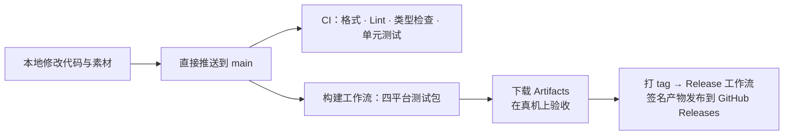

# Yohaku 改造计划与里程碑

> 版本 v1 · 2026-10-30 · 依据：[可行性评估](01-feasibility.md)、[系统架构](02-architecture.md)
> 本计划在技术路线确认后生效；每个 Phase 结束时回顾并更新本文。

---

## 总览

| Phase | 主题 | 规模 | 关键交付 | 对应版本 |
|---|---|---|---|---|
| 0 | 基础建立 | M | Fork Readest、改名、去云端化、四平台 CI 打通 | `v0.0.x` |
| 1 | 阅读核心验证与精修 | M | 格式与漫画验证、Yohaku 阅读主题；并行完成 4 个技术 Spike | `v0.1.0` |
| 2 | 音乐与环境声音 | XL | 双原生音频引擎、音乐库、环境声音混音、Android 后台播放 | `v0.2.0` |
| 3 | 暗室 Anshitsu | L | 悬挂照片的书库、显影、摆动、翻转、自由整理 | `v0.3.0` |
| 4 | 留声机 | L | 唱片柜、唱盘与唱臂、播放仪式、播放列表收藏盒 | `v0.4.0` |
| 5 | 日式艺术系统 | XL | 雨、夕阳、风铃、伞、萤火虫、海月与泡沫、樱花、烟花、蝉鸣、四季 | `v0.5.x` |
| 6 | 记忆与精修 | L | 声音书签、胶卷记忆、私人场景、备份导出、无障碍与性能、上架准备 | `v1.0.0` |

规模：S ≤ 1 周，M 2–4 周，L 4–6 周，XL 6 周以上。这是规划用的粗略估计，Spike 完成后会重新评估。

---

## 工作方式（全部在 GitHub 上完成）

- **分支**：直接推送到 `main`，不使用功能分支与 PR。CI 与构建在每次推送时运行；同一分支上新的推送会取消仍在进行的旧运行，所以相关改动尽量合并成一次推送。
- **自动化测试**：Vitest（前端与领域服务）、Rust 单元测试（含音频引擎离线渲染测试）、Kotlin JVM 单元测试、Playwright（使用 Mock 音频引擎测试空间与列表界面，并上传截图供审阅）、Android 模拟器冒烟测试（复用 Readest 的 `android-e2e.yml`）、Linux AppImage 在 xvfb 下的启动测试。
- **真机验收**：CI 无法测量真实的后台播放、厂商杀进程、帧率与耗电，这部分由你在自己的设备上用 CI 产出的测试包完成。每个 Phase 附带一份验收清单。
- **建议的测试设备**：一台中端 Android（Android 13–16），最好再有一台旧设备（Android 8–10）用于低性能测试；你的 Mac；一台 Windows 电脑或虚拟机；一台 Linux 虚拟机（Ubuntu 24.04）。

---

## Phase 0 — 基础建立

**目标**：得到一个可以在四个平台安装、名为 Yohaku、完全离线、阅读功能完整的应用，并打通全部云端构建。

### 任务

- [x] **P0-1 导入 Readest**：以最新稳定版 `v0.12.16` 为基线（发布版比 `main` 更稳定），添加 `upstream` 远程仓库，以 `--allow-unrelated-histories` 合并并保留完整历史；解决 README 与 `.gitignore` 冲突；确认子模块在 CI 中可以完整拉取。
- [x] **P0-2 Yohaku 项目说明**：新增面向 Yohaku 的 `CLAUDE.md` / `AGENTS.md`，替换 Readest 维护者专用的流程说明（社区 PR 审查、维护循环、gstack 技能路由等），指向 `docs/yohaku/`。
- [x] **P0-3 品牌替换**：按[架构 §2.3](02-architecture.md#23-品牌替换清单)执行；Android 包名、`MainActivity` 路径、数据目录、深链接、图标（占位）、i18n 品牌后处理器、关于页致谢。
- [x] **P0-4 去云端化**：按[架构 §7](02-architecture.md#7-readest-裁剪清单)中 P0 项执行；首先删除 `.env` 中的默认密钥；新增 `src/yohaku/build.ts`（`isYohakuBuild()`，由 `.env.tauri` 的 `NEXT_PUBLIC_YOHAKU_BUILD` 打开）；收紧 CSP；关闭更新器；移除受限权限（Google Play 渠道）。
- [x] **P0-5 CI/CD**：按 [04 · 构建与发布](04-ci-release.md)新建 `ci.yml`、`build.yml`、`release.yml`，删除无关工作流；加入「禁止外联」检查、Android 16 KB 对齐与权限审计、AAB 构建。
- [x] **P0-6 密钥**：你在本地生成 Android keystore 并上传到 GitHub Secrets（步骤见 [04 §5](04-ci-release.md#5-签名与密钥管理)）。本地副本放在仓库内的 `key/`，该目录已被 `.gitignore` 排除。
- [ ] **P0-7 首个预发布**：`v0.0.1` 作为 GitHub Pre-release 发布全部平台产物（应用版本号只用纯数字，见 [04 §4](04-ci-release.md#4-产物命名)）。

实际改动逐项登记在 [upstream-patches.md](upstream-patches.md)，其中也列出了暂缓的差异（`readest://` 深链接、数据子目录名等）。

### 验收

- 四平台产物全部由 CI 生成：Windows（NSIS 安装包 + 便携版）、Linux（AppImage + deb）、macOS（DMG）、Android（APK + AAB）。
- 安装后显示 Yohaku 名称与图标；关于页写明基于 Readest（AGPL-3.0）并附源码地址。
- 「禁止外联」检查通过；**断网状态下**首次启动、导入、阅读、关闭重开全部正常。
- EPUB、AZW3、PDF、CBZ、TXT、Markdown 均可打开；重启后阅读进度保留。
- Android 产物通过 16 KB 对齐检查与权限审计，`targetSdk = 36`。

---

## Phase 1 — 阅读核心验证与精修

### 任务

- [ ] 建立测试书库（见文末「测试素材」），在 CI 中自动下载或生成，不把受限内容提交到仓库。
- [ ] 格式验证矩阵：每种格式 × 四个平台，覆盖打开、目录、搜索、批注、书签、进度保存、重启恢复。
- [ ] 新增阅读主题「暖纸」「月白」「墨夜」，以及中文、日文、英文的默认排版参数（字号、行距、段距、页边距、竖排）。
- [ ] 漫画：依据 ComicInfo `Manga=YesAndRightToLeft` 自动设为从右到左；新增「漫画默认从右到左」全局选项；验证跨页、Webtoon、缩放与拖动在 Android 上的手势。
- [ ] PDF：用 300 MB 以上扫描版 PDF 测试中端手机的内存与翻页延迟，必要时调整 pdf.js 参数。
- [ ] 隐藏阅读统计中的连续天数（streak）。

### 技术验证（Spike，与 Phase 1 并行）

每个 Spike 产出一份简短报告（`docs/yohaku/spikes/`），包含测量数据与结论。

| Spike | 内容 | 通过标准 | 不通过时的备选 |
|---|---|---|---|
| **S1 Android 后台音频** | 在 Yohaku 中实现最小的 Media3 `MediaSessionService` 插件：播放 MediaStore 中的 24-bit FLAC，叠加 3 个环境层 | 锁屏 60 分钟连续播放；锁屏与蓝牙按键可用；拔出耳机暂停；来电暂停并恢复；开启开发者选项「不保留活动」后仍继续播放，重新打开应用后界面同步；睡眠定时按时淡出 | Rust 引擎（cpal AAudio）+ Kotlin 会话门面；或降级为 Readest 有声书的 WebView 播放方式（仅保证单音轨） |
| **S2 艺术层性能** | 暗室原型：30 张照片摆动 + 窗户雨滴着色器 + 8 只萤火虫；对比 PixiJS v8 与原生 WebGL2 | 中端 Android 平衡档 ≥ 30 fps；30 分钟耗电不超过静态画面的 1.3 倍；WebGL 上下文丢失后可恢复 | 降低默认档位；天气改用硬件解码的预渲染视频循环；更多静态美术 |
| **S3 Linux CEF** | 以 Yohaku 品牌构建 CEF 版 AppImage 与 deb | CI 中 xvfb 启动成功并截图；Ubuntu 22.04 / 24.04 虚拟机中可正常运行 | 回退 WebKitGTK 并在 Linux 上默认使用平衡档 |
| **S4 桌面音频引擎** | rodio + symphonia + cpal 最小引擎 | 离线渲染测试证明两曲之间无空白采样；设备切换后自动恢复；音源 44.1 kHz、设备 48 kHz 时的重采样质量与 CPU 占用可接受 | 直接使用 symphonia 解码 + rubato 重采样 + cpal 输出的自写管线 |

### 验收

- 格式验证矩阵全部通过，问题有记录与处理结论。
- 4 个 Spike 均有报告，音频与渲染方案最终确定，并回写到架构文档。

---

## Phase 2 — 音乐与环境声音

### 任务

- [ ] `tauri-plugin-yohaku-audio`：统一接口（[架构 §3.2](02-architecture.md#32-统一接口)）、桌面 Rust 引擎、Android Kotlin 服务、Mock 引擎。
- [ ] 音乐库：来源管理（桌面文件夹、Android MediaStore 与 SAF）、扫描、元数据与封面、专辑 / 艺术家 / 歌曲 / 播放列表、搜索与排序、传统列表视图。
- [ ] 播放：队列、随机、循环、无缝播放、进度记忆、独立音量、输出设备变化、耳机拔出、音频焦点。
- [ ] 系统媒体控制：桌面复用 souvlaki，并与朗读互斥；Android 通知栏、锁屏、蓝牙按键。
- [ ] 环境声音：声音层目录、5 个默认场景、混音界面、预设保存、睡眠定时器、一键静音；首批环境音素材及授权登记。
- [ ] 极简播放界面（Phase 4 的留声机与 Phase 5 的海月在此基础上构建）。

### 验收

- 自动化：引擎离线渲染测试（无缝、渐变、睡眠定时）、队列与状态机单元测试、曲库扫描测试、迁移测试。
- 真机：Android 锁屏连续播放 2 小时不中断；整张专辑无缝播放；阅读时翻页、换书、改字体音乐不中断；音乐与 3 个环境层同时播放且音量互不影响；进程被系统回收后可通过蓝牙「播放」恢复。

---

## Phase 3 — 暗室 Anshitsu

### 任务

- [ ] Yohaku 外壳：空间导航（暗室 / 留声机 / 海月 / 记忆）、首页设置（可选择传统书库为首页）、动态效果四档设置。
- [ ] SceneScheduler 与 Verlet / 单摆物理基础。
- [ ] 暗室场景：细绳（可增删、可调高度）、木夹、相纸照片、风力摆动、拖动与重新悬挂、布局持久化。
- [ ] 显影动画（导入书籍时触发，可跳过）。
- [ ] 打开书籍的共享元素过渡；长按翻转与背面信息卡（私人留言、最喜欢的一句话、陪伴阅读的歌曲）。
- [ ] 「陪伴阅读的歌曲」记录（`reading_listening`）。
- [ ] 移动端专属布局与手势；键盘与读屏操作；正式应用图标与暗房美术素材。

### 验收

- 暗房与传统书库视图数据一致，可随时切换。
- 中端 Android 平衡档达到性能预算；减少动态效果时完全静止。
- TalkBack / VoiceOver / NVDA 可以完成「找到一本书 → 打开 → 查看背面信息」。

---

## Phase 4 — 留声机

### 任务

- [ ] 唱片柜：专辑封套（真实封面）、分格分类、拖动整理、虚拟滚动。
- [ ] 播放列表收藏盒。
- [ ] 唱盘、唱臂与播放仪式（完整 / 简短 / 关闭三档，可随时跳过）；曲目列表、进度与音量面板。
- [ ] 唱片底噪环境层（默认关闭）。
- [ ] 与暗房的连接方式（独立房间或暗房中的音乐角落），桌面与移动端各自的布局。

### 验收

- 关闭仪式或在列表中播放时，从点击到出声 < 300 ms。
- 仪式进行中任何时候轻触都能立即开始播放。
- 1,000 张专辑的唱片柜滚动流畅。

---

## Phase 5 — 日式艺术系统

逐个交付，每个意象都独立可用、可关闭，并有性能测试。建议顺序：

1. **雨 Ame**：窗户雨滴着色器与雨声场景联动。
2. **夕阳 Yūyake**：时间状态机、琥珀色窗光、台灯。
3. **风铃 Fūrin**：摆动、触碰发声、短册诗句、独立音量与最短间隔。
4. **伞 Kasa**：沉浸式阅读入口与过渡。
5. **萤火虫 Hotaru**：与收藏的句子关联，数量上限，停留在对应书籍照片旁。
6. **海月 Kurage 与泡沫 Awa**：水族馆空间、水母种类与颜色、环境光联动、气泡交互。
7. **樱花 Sakura**：春季主题、落在窗沿与桌面的花瓣、樱花书签。
8. **烟花 Hanabi**：自愿启动的完读仪式，结束时生成一格胶片。
9. **蝉鸣与四季**：季节引擎、各季可用意象的组合。

### 验收

- 每个意象都满足[架构 §5.6](02-architecture.md#56-九种意象与补充元素)中的克制规则。
- 导演规则生效：任何时刻屏幕上不会同时出现超过一种天气与一种生物。
- 全部意象开启时，中端 Android 平衡档仍满足性能预算。

---

## Phase 6 — 记忆与精修

### 任务

- [ ] 声音书签：收藏句子时可记录当前歌曲与位置，在照片背面与批注中一键重放。
- [ ] 胶卷记忆：自动与手动生成胶片，按年份拖动浏览，提供时间线列表视图。
- [ ] 私人阅读场景：保存与恢复（书籍、位置、音乐、环境声音、主题、音量）。
- [ ] 每日自动备份、「收藏箱」导出与导入。
- [ ] 无障碍全面审查（TalkBack、VoiceOver、NVDA、Orca、纯键盘）。
- [ ] 性能与耗电回归测试；低性能设备专项优化。
- [ ] 国际化（简中、繁中、日文、英文）。
- [ ] Google Play 上架准备：AAB、商店信息、数据安全表单（不收集数据）、前台服务类型声明、内容分级。
- [ ] `v1.0.0` 发布。

---

## 持续事项

- **上游同步**：每月合并一次 Readest，更新 `docs/yohaku/upstream-patches.md`。
- **素材授权**：每新增一个素材都登记到 `assets-src/LICENSES.md`。
- **数据安全**：任何涉及数据表的改动都必须附带迁移测试。
- **发布说明**：每个版本在 GitHub Releases 中写明变化与已知问题。

---

## 测试素材（均可公开再分发或在 CI 中生成）

| 类型 | 来源 | 说明 |
|---|---|---|
| EPUB（英文） | [Standard Ebooks](https://standardebooks.org/)（CC0） | 可直接放入测试仓库 |
| EPUB / TXT（日文、竖排） | [青空文库](https://www.aozora.gr.jp/)（公有领域作品） | CI 中下载并转换 |
| EPUB / TXT（中文） | 公有领域古典文学；另生成 GBK / GB18030 编码的 TXT | 覆盖中文 TXT 编码识别 |
| AZW3 | 在 CI 中用 Calibre 由 EPUB 转换生成 | 不提交生成物 |
| 漫画（从左到右） | [Pepper&Carrot](https://www.peppercarrot.com/)（CC BY 4.0） | 打包为 CBZ |
| 漫画（从右到左） | 候选：佐藤秀峰《ブラックジャックによろしく》（作者开放二次使用，需核对条款） | 验证 RTL 与跨页 |
| Webtoon 长图 | 在 CI 中生成 | 超长图片与无缝拼接 |
| PDF（文字版 / 扫描版 / 超大文件） | 在 CI 中生成；扫描版取自公有领域扫描书 | 性能测试 |
| 音乐 | 在 CI 中用 ffmpeg / sox 生成连续扫频并切分为多轨（FLAC 16/24-bit、MP3、AAC、WAV） | 无缝播放与编解码覆盖；人工试听另用 CC 授权音乐 |
